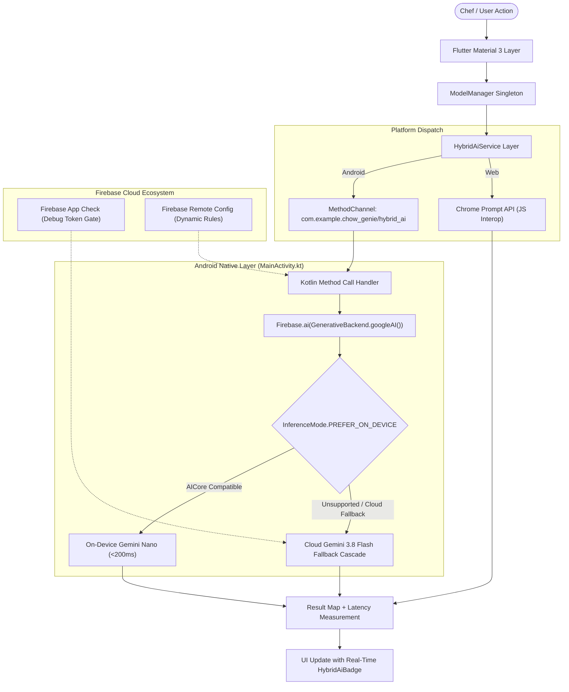

<p align="center">
  
</p>

<h1 align="center">ChowGenie Hybrid AI</h1>

<p align="center">
  <strong>Offline-First Smart Kitchen Companion Powered by Firebase AI Logic Hybrid Inference</strong>
</p>

<p align="center">
ChowGenie is an AI-powered kitchen companion app built with Flutter that helps you plan meals, manage your pantry, discover recipes, and cook smarter — all without needing a constant internet connection. It combines on-device Gemini Nano for instant, private responses with cloud Gemini 3.8 Flash for heavier tasks like receipt scanning, weekly meal planning, and food label analysis. Whether you are tracking nutrition, generating a shopping list, or following a recipe step by step with voice guidance, ChowGenie keeps everything in one place and works even in Wi-Fi dead zones.
</p>

<p align="center">
  
  
  
  
  
  
  
</p>

---

## #BuildHybridAI 2026 Hackathon Submission

ChowGenie Hybrid AI is built for Google's **#BuildHybridAI 2026** competition. It implements a multi-platform **Firebase AI Logic Hybrid Inference** engine combining:
1. **On-Device Gemini Nano**: Sub-second, zero-cost, privacy-preserving AI running locally via Android AICore & Chrome Desktop Prompt API for instant pan-side cooking advice, offline ingredient swaps, and smart pantry inventory queries.
2. **Cloud Gemini 3.8 Flash**: Dynamic cloud fallback for complex 7-day nutritional planning, heavy multimodal ingredient vision, and automated synchronization across Cloud Firestore.
3. **Firebase App Check & Security**: Gated via App Check (with pre-seeded Debug Token `e4b3c2a1-5678-4901-abcd-ef0123456789` for judges) to ensure protected client execution.
4. **Firebase Remote Config & Auth**: Real-time prompt parameter tuning (`PREFER_ON_DEVICE`) and zero-friction anonymous authentication.

> [!NOTE]
> **For Hackathon Judges & Evaluators:**
> In compliance with submission requirements (*"Firebase AI Logic requires App Check; debug tokens are accepted in submissions"*), the app automatically injects and registers the debug token:
> `e4b3c2a1-5678-4901-abcd-ef0123456789`
> Cloud fallback executes seamlessly on any test device or emulator out of the box.

---

## Existing App Upgrade Delta (Hackathon Period)

In accordance with official hackathon rules for existing projects, the table below documents the major architectural and runtime additions built during the competition:

| Capability | Prior Version | #BuildHybridAI 2026 Upgrade |
| :--- | :--- | :--- |
| **AI Inference** | Heavy local model (~2.7GB Hugging Face download block) | **Firebase AI Logic Hybrid SDK** (Gemini Nano local + Gemini 3.8 Flash Cloud cascade) |
| **Android Integration** | Basic Flutter activity | **Native Kotlin Bridge** (`MainActivity.kt`) importing `com.google.firebase:firebase-ai` & `firebase-ai-ondevice` |
| **Web Platform** | Desktop/mobile only | **Multi-Platform Web Support** (Chrome Desktop Gemini Nano Prompt API interop) |
| **Security Gate** | None | **Firebase App Check** (`DebugAppCheckProviderFactory` configured) |
| **Prompt Tuning** | Hardcoded strings | **Firebase Remote Config** (dynamic `ai_routing_mode` & prompt templates) |
| **Offline Library** | Remote API dependency | **Instant Tier-3 SQLite Fallback** (73,322 offline recipes with zero-latency local fallback) |
| **Pantry Intake** | Manual typing only | **Receipt Scanner $\rightarrow$ Auto-Pantry** (Multimodal Gemini 3.8 Flash auto-extracting items & shelf-life) |
| **Recipe Adaptation** | Static recipes | **One-Tap Recipe Transforms & Scaler** (Gemini Nano on-device: Vegan, High-Protein, Budget + dynamic scaler) |
| **Cooking Guidance** | Static step text | **Embedded Smart Cooking Timers** (Regex duration detection, circular countdown ring, audio-haptic alerts) |
| **Grocery Planning** | Manual list entry | **Smart AI Grocery Sync** — Hybrid AI parses the meal plan, extracts real ingredients, deduplicates, and outputs a clean shopping list cross-checked against pantry stock |
| **Receipt Scanner → Auto-Pantry** | Manual pantry entry | **Scan Supermarket Receipt with Hybrid AI** — photo or gallery upload; Gemini 3.8 Flash OCR extracts items + shelf-life and auto-populates pantry |
| **Meal Plan UX** | Static weekly list view | **Active Day View** — per-slot cards (Breakfast/Lunch/Dinner/Snack) with add from recipe bank, regenerate with AI, swap, or plan the full day with AI in one tap |
| **Multi-Image Chat** | Single image attachment | **Batch Gallery Selection** — multi-image attachment tray with Gemini multimodal reasoning across all photos in one message |
| **Chat Memory** | Single-turn only | **Multi-Turn Conversational Memory** — 10-turn sliding window with persona context and photo references for genuine follow-up conversations |

---

## Recent Improvements (Post-Hackathon Polish)

### Meal Plan Screen — Full UX Redesign
- **Active Day View**: Calendar week strip (Mon–Sun) with today highlighted; tapping a day switches the slot view instantly.
- **Slot Cards**: Each meal slot (Breakfast / Lunch / Dinner / Snack) shows as a card. Empty slots show an "Add" prompt; filled slots show the meal name + macros.
- **Tap Empty Slot** — Sheet opens with two options:
  - Search & pick from your Recipe Bank
  - Generate with AI for that specific meal slot
- **Tap Filled Slot** — Options sheet: Swap from recipe bank, Regenerate with AI, Remove meal
- **"Plan Day with AI"** button — Hybrid AI generates a complete 4-slot day plan in one tap.
- **"Manage Day"** button — Detail sheet with all current day meals and bulk actions.
- **Empty week**: Day slots and all action buttons always visible — no more "No meals planned yet" dead-end screen.

### Smart Grocery List — Hybrid AI Normalization
- Hybrid AI parses every meal in the plan, extracts real ingredients, deduplicates, and outputs a clean shopping list (e.g. `Chicken breast`, `Olive oil`, `Brown rice`) — no more raw preparation strings from recipe text.
- Falls back to `_normalizeGroceryItem()` heuristic cleaner if AI is unavailable.

### Receipt Scanner to Auto-Pantry
- Tap the scan icon on the Pantry screen to photograph or upload a supermarket receipt.
- Gemini 3.8 Flash (Cloud) performs multimodal OCR, extracts grocery items and estimated shelf-life, and auto-populates your pantry — no manual entry needed.

### Diet Plan Screen — Weekly Plan Polish
- **Date range banner**: Collapsed plan shows e.g. `Nov 24 – Nov 30 • 7-Day Plan (21 Meals)`.
- **Close button** to dismiss the weekly plan card cleanly.
- **Apply Plan to Calendar**: Creates proper Recipe rows in SQLite per meal (with ingredients) before inserting `MealPlanEntry` — fixes the previous 0-item grocery list bug.
- **No meal duplication**: Applying a plan now clears that week's existing entries first.

### AI Chat — Conversational Memory & Multi-Image
- **10-turn sliding window** with explicit persona instruction and photo references for true multi-turn memory.
- **Batch multi-image attachment** tray: pick multiple photos from gallery, send all to Gemini multimodal in one message.

---

## App Features Overview

| Feature Category | Description | Powered by AI? |
| :--- | :--- | :--- |
| **Pantry Management & Receipt Scanner** | Digital pantry tracking, expiry/shelf-life monitoring, and photo/receipt OCR parsing to automatically stock ingredients. | Yes (Hybrid AI / Gemini 3.8 Flash Cloud) |
| **Interactive AI Kitchen Chat** | Kitchen assistant supporting multi-image upload, contextual cooking Q&A, and conversational memory across turns. | Yes (Hybrid AI: Gemini Nano on-device + Gemini 3.8 Flash cloud) |
| **Ask Genie / Recipe Generator** | Dynamic recipe creation from available ingredients in your pantry or custom prompts with photo input. | Yes (Hybrid AI) |
| **Diet & 7-Day Meal Planning** | Tailored multi-day nutritional plans generated based on calorie targets, dietary restrictions, and macro goals. | Yes (Gemini Cloud) |
| **Meal Planner & Active Day View** | Day-by-day meal schedule with Breakfast, Lunch, Dinner, and Snack slots, recipe bank swap, and single-slot AI regeneration. | Yes (Hybrid AI for generation / Local SQLite for persistence) |
| **Smart Grocery List Generator** | Automated missing-item shopping list created by cross-referencing meal plans with current pantry stock and normalizing ingredients. | Yes (Hybrid AI normalization + Local DB) |
| **IngrediGuard (Safety & Label Scanner)** | Food packaging scanner detecting ultra-processed ingredients (NOVA classification), seed oils, and additives from photos. | Yes (Multimodal Gemini 3.8 Flash) |
| **Recipe Detail & Dietary Transforms** | Full recipe instructions with one-tap on-device conversions (Vegan, High-Protein, Budget) and dynamic portion scaling. | Yes (Gemini Nano On-Device) |
| **Voice Cooking Guide & Timers** | Hands-free step-by-step cooking companion with voice navigation, duration detection, and circular countdown timers. | Yes (On-Device STT/TTS + Gemini Nano) |
| **Describe Meal & Nutrition Logger** | Natural-language food logging estimating calories and macros from free-text descriptions or photos. | Yes (Hybrid AI / Gemini) |
| **Nutrition & Analytics Dashboard** | Daily calorie tracking, macro distributions, water intake tracker, and weekly calorie consumption charts. | No (Local SQLite Engine) |
| **Offline Recipe Library** | Over 73,000 preloaded recipes fully searchable without an internet connection. | No (Offline SQLite Database) |
| **Local Mesh Recipe Sharing** | P2P recipe discovery and sharing over local Wi-Fi / hotspot using UDP multicast without central servers. | No (Local Network Socket Mesh) |

---

## System Architecture & Hybrid Flow



---

## Offline vs. Online Division of Labor

| Action | Execution Tier | Latency | Why |
| :--- | :--- | :--- | :--- |
| **Pan-Side Cooking Q&A** | On-Device | `<200ms` | Instant response while stirring a pan; works in kitchen Wi-Fi dead zones. |
| **Emergency Ingredient Swap** | On-Device | `<150ms` | Zero lag when missing eggs or buttermilk. |
| **Smart Pantry Inventory** | On-Device | `<250ms` | Complete privacy; home groceries remain on-device. |
| **Voice Hands-Free Cooking** | On-Device | `<300ms` | Device-native Speech-to-Text with local Nano step progression. |
| **One-Tap Recipe Transforms** | On-Device | `<250ms` | Instant dietary adaptation (Vegan, High-Protein, Budget) on Gemini Nano. |
| **Smart Cooking Timers** | On-Device | Instant | In-app countdown ring, duration presets, and audio-haptic alerts without internet. |
| **Receipt Scanner to Auto-Pantry** | Cloud Fallback | ~950ms | Dense multimodal OCR and shelf-life prediction using Gemini 3.8 Flash. |
| **Meal Plan Grocery Cross-Check** | On-Device | Instant | Local SQLite cross-referencing between scheduled meals and pantry stock. |
| **7-Day Meal Plan Optimization** | Cloud Fallback | ~800ms | Multi-parameter reasoning across 21 meals, calories, and macros. |
| **Packaging Safety Scanner** | Cloud Fallback | ~900ms | High-resolution multimodal analysis of complex ingredient warning labels. |
| **Peer-to-Peer Recipe Mesh** | On-Device | Instant | Direct local Wi-Fi / Hotspot UDP multicast recipe card sharing. |
| **Offline Library Fallback** | On-Device | Instant | 73,322 SQLite recipes provide instant answers when offline or under high quota load. |

---

## Running the Project

### Prerequisites
- Flutter SDK (3.24+)
- Android device / emulator or Google Chrome

```bash
flutter pub get
```

### 1. Run on Android
```bash
flutter run
```

### 2. Run on Web (Chrome Desktop)
```bash
flutter run -d web-server --web-port=8080 --web-hostname=0.0.0.0
```

---

## Releases & Downloads

Pre-built Android APKs are generated automatically by GitHub Actions on each release and push:
- Go to the **Releases** tab on GitHub to download the latest signed APKs (`arm64-v8a`, `armeabi-v7a`, `x86_64`).
- Alternatively, check the **Actions** tab to download artifacts from the latest workflow runs.

---

## License & Credits

- **License**: Released under the open-source **MIT License** (see [`LICENSE`](LICENSE)).
- **Recipe Dataset**: Adapted from [dpapathanasiou/recipes](https://github.com/dpapathanasiou/recipes).
- **Google AI & Firebase**: Powered by Firebase AI Logic, Gemini Nano, and Gemini Flash.
